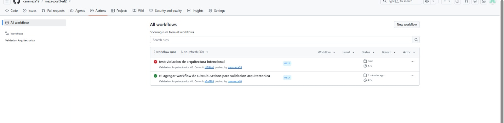
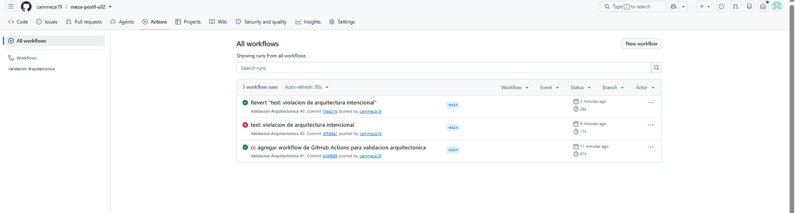

# Sistema de Solicitudes de Reembolso de Gastos Corporativos
**Proyecto Integrador — Unidad 12: Integración de Patrones y Arquitecturas**
*Patrones de Diseño de Software · Universidad de Santander (UDES)*

* **Estudiante:** Camila Meza
* **Repositorio:** [https://github.com/cammeza19/meza-post1-u12](https://github.com/cammeza19/meza-post1-u12)
* **Stack:** Java 17 · Spring Boot 4.1.2 (Spring Web MVC, Spring Data JPA, H2) · ArchUnit 1.2.1 · GitHub Actions


## Contenido
1. [Diseño Propuesto](#1-diseño-propuesto)
2. [Arquitectura resultante](#2-arquitectura-resultante)
3. [Decisiones de Diseño 1 a 4](#3-decisiones-de-diseño)
4. [Resumen de ADR-001](#4-resumen-de-adr-001-persistencia-y-notificación)
5. [Qué se descartó y por qué](#5-qué-se-descartó-y-por-qué-análisis-de-impacto)
6. [Pruebas](#6-pruebas)
7. [Evidencias del pipeline de GitHub Actions](#7-evidencias-del-pipeline-de-github-actions)
8. [Cómo ejecutar](#8-cómo-ejecutar)

---

## 1. Diseño Propuesto

> Esta sección se redactó **antes de escribir cualquier código de patrones** (commit de línea base `ae95619`, que solo contiene `pom.xml`, el modelo de dominio y este análisis). En la consolidación final solo se añadió la línea "¿Por qué este y no otro?" de cada requisito.

### RF1 — Validación en varias etapas
* **Punto de variabilidad:** La secuencia y cantidad de reglas de validación independientes que deben cumplirse antes de autorizar una solicitud, con previsión de añadir nuevas verificaciones futuras (como topes acumulados anuales) sin alterar las existentes.
* **Patrón de diseño:** **Chain of Responsibility (Cadena de Responsabilidad)**.
* **Justificación (test de explicabilidad):** Permite desacoplar el emisor de la solicitud de sus validadores concretos, encadenando eslabones autónomos que deciden individualmente si aprueban o detienen la evaluación sin que ninguno conozca la estructura global de la cadena.
* **¿Por qué este y no otro?** Un bloque de `if` en el servicio obligaría a editarlo con cada verificación nueva, y Strategy elige *una* variante mientras que aquí deben ejecutarse *todas* en orden con corte temprano: eso es exactamente lo que hace una cadena.

### RF2 — Cálculo distinto por categoría de gasto
* **Punto de variabilidad:** El algoritmo de liquidación del monto aprobado según el tipo de gasto (viáticos, representación, capacitación), el cual variará a medida que Finanzas incorpore nuevas categorías.
* **Patrón de diseño:** **Strategy (Estrategia) + Selector de estrategias**.
* **Justificación (test de explicabilidad):** Encapsula cada fórmula de liquidación en clases intercambiables que implementan un contrato común, permitiendo incorporar nuevas categorías de gasto simplemente registrando un nuevo componente de Spring sin modificar las clases de cálculo existentes ni introducir estructuras condicionales rígidas.
* **¿Por qué este y no otro?** Las tres fórmulas no comparten un esqueleto común que justifique Template Method, y un `switch` sobre `CategoriaGasto` violaría Open/Closed cada vez que Finanzas agregue una categoría.

### RF3 — Notificación simultánea a varios interesados
* **Punto de variabilidad:** La multiplicidad y heterogeneidad de receptores (empleado, contabilidad, auditoría) que deben reaccionar ante una transición de estado, con la expectativa de sumar nuevos suscriptores (como paneles de analítica).
* **Patrón de diseño:** **Observer (Observador)**.
* **Justificación (test de explicabilidad):** Establece un mecanismo de suscripción desacoplado de uno a muchos donde el servicio de reembolsos difunde los cambios de estado sin conocer la identidad ni las acciones específicas que ejecuta cada parte interesada.
* **¿Por qué este y no otro?** Llamar directamente a cada interesado desde el servicio lo acoplaría a los tres y obligaría a editarlo para el panel de métricas ya anunciado; Mediator sobraría porque los interesados no se comunican entre sí.

---

## 2. Arquitectura resultante

Arquitectura **en capas simples** (ver ADR-001) con los tres patrones aislados en `procesamiento`:

```
src/main/java/com/empresa/reembolsos/
├── ReembolsosApplication.java
├── dominio/                    SolicitudReembolso, CategoriaGasto, EstadoSolicitud
├── procesamiento/              lógica pura, sin JPA ni web (Regla 1)
│   ├── validacion/             RF1 · Chain of Responsibility
│   │                           ValidadorSolicitud, ResultadoValidacion, CadenaValidadores,
│   │                           ValidadorDocumentosSoporte, ValidadorMontoMaximo, ValidadorDuplicados
│   ├── calculo/                RF2 · Strategy
│   │                           CalculadoraReembolso, SelectorCalculadora,
│   │                           CalculadoraViaje, CalculadoraRepresentacion, CalculadoraCapacitacion
│   └── notificacion/           RF3 · Observer
│                               ObservadorCambioEstado, NotificadorEmpleado,
│                               NotificadorContabilidad (solo APROBADA), NotificadorAuditoria
├── aplicacion/                 SolicitudReembolsoService (único coordinador), SolicitudInvalidaException
├── infraestructura/            RepositorioSolicitudesJpa (JpaRepository, sin puerto intermedio)
└── adaptadores/rest/           SolicitudReembolsoController, ManejadorErroresRest
```

**Dirección de dependencias:** `adaptadores.rest → aplicacion → {procesamiento, infraestructura} → dominio`. El servicio de aplicación es el único que conoce a la vez los tres patrones y el repositorio; `ValidadorDuplicados` recibe las solicitudes pendientes ya cargadas, por lo que `procesamiento` no toca la base de datos.

**API REST**

| Método | Ruta | Cuerpo | Respuesta |
|---|---|---|---|
| `POST` | `/api/solicitudes` | `SolicitudReembolso` (JSON) | `200` con monto aprobado y estado `PENDIENTE`; `400` con el motivo si la cadena la rechaza |
| `PUT` | `/api/solicitudes/{id}/estado` | `"APROBADA"` · `"RECHAZADA"` · `"REQUIERE_CORRECCION"` | `200` y notifica a los 3 observadores; `404` si el id no existe |

---

## 3. Decisiones de Diseño

### Decisión de Diseño 1: Orden de ejecución en la cadena de validadores
* **Contexto:** Se deben encadenar los validadores de documentos soporte, monto máximo y solicitudes duplicadas en `CadenaValidadores`.
* **Elección:** Documentos → Monto → Duplicados, de menor a mayor costo: `ValidadorDocumentosSoporte` lee un booleano (O(1)), `ValidadorMontoMaximo` consulta un mapa de topes (O(1)) y `ValidadorDuplicados` recorre la lista de pendientes del empleado (O(N)).
* **Qué se gana (fail-fast):** las solicitudes inválidas por causas baratas se descartan sin recorrer la colección. Si los duplicados fueran primero, se pagaría el recorrido incluso para solicitudes que de todos modos se rechazan por no traer documentos.
* **Qué se pierde:** cuando una solicitud tiene varios defectos, el empleado solo ve el primer motivo (documentos) y descubre el duplicado en un segundo intento; además, si se ubicara el duplicado primero, el empleado sabría de entrada que ya tiene una solicitud abierta y no se molestaría en reunir documentos.
* **Límite honesto del argumento:** la consulta a base de datos (`findByEmpleadoIdAndEstado`) la hace el servicio *antes* de invocar la cadena, así que el orden solo ahorra el recorrido en memoria, no la consulta. Con el volumen esperado (pocas pendientes por empleado) la diferencia es pequeña; se mantiene el orden por ser el criterio correcto si la cadena crece (p. ej. un futuro validador de límite anual acumulado iría también al final).

### Decisión de Diseño 2: Selección de estrategias (mapa inyectado por Spring vs. `switch` manual)
* **Contexto:** Hay que despachar cada solicitud a la calculadora de su `CategoriaGasto`, y Finanzas agregará categorías nuevas (p. ej. "bienestar") en los próximos semestres.
* **Elección:** `SelectorCalculadora` recibe `List<CalculadoraReembolso>` (Spring inyecta todos los `@Component` que implementan la interfaz) y la convierte en un `Map<CategoriaGasto, CalculadoraReembolso>`.
* **Justificación (Open/Closed):** añadir "bienestar" requiere solo dos adiciones —el valor `BIENESTAR` en el enum y la clase `CalculadoraBienestar`— sin modificar ninguna línea del selector ni de las otras calculadoras. Con un `switch`, cada categoría nueva obliga a editar el método existente, lo que viola OCP y arriesga regresiones en las categorías ya probadas.
* **Costo aceptado:** si dos calculadoras declararan la misma categoría, `Collectors.toMap` falla al arrancar la aplicación; se considera una ventaja (el error aparece en el arranque, no en producción) y la Regla 3 de ArchUnit garantiza que toda calculadora cumpla el contrato.

### Decisión de Diseño 3: Capas simples para persistencia vs. Hexagonal completa (ADR-001)
* **Contexto:** Decidir si `SolicitudReembolsoService` debe depender de un puerto `RepositorioSolicitudes` con adaptador JPA, y si `procesamiento.notificacion` necesita cambios ante la integración externa anunciada por Contabilidad.
* **Elección:** Persistencia en capas simples (el servicio depende directamente de `RepositorioSolicitudesJpa`); notificación sin cambios, porque `ObservadorCambioEstado` ya es el *seam*.
* **Justificación:** El criterio de la Guía (Hexagonal si el sistema vivirá 3 años o más **con cambios de infraestructura**) no se cumple para la persistencia: no hay ningún plan de cambiar el motor de base de datos, por lo que un puerto sería especulación (**YAGNI**) e indirección sin beneficio (**KISS**). Sí se cumple para la notificación (hay un cambio con fecha: la API de Contabilidad del próximo trimestre), pero ese punto de extensión ya existe gracias al Observer. Detalle completo en [`docs/adr/ADR-001.md`](docs/adr/ADR-001.md).

### Decisión de Diseño 4: La Regla 1 distingue anotaciones de estereotipo de dependencias técnicas
* **Contexto:** La Regla 1 prohíbe que `procesamiento` dependa de `infraestructura`, `adaptadores`, `org.springframework.data..`, `jakarta.persistence..` y de la capa web (`org.springframework.web..`, `org.springframework.http..`, `jakarta.servlet..`), pero **no** de todo `org.springframework`: los validadores, calculadoras y notificadores siguen usando `@Component`.
* **Justificación:** `@Component` (paquete `org.springframework.stereotype`) es un metadato declarativo para que el contenedor ensamble la cadena, las estrategias y los observadores; no cambia el comportamiento de las clases, que se siguen instanciando con `new` en las pruebas unitarias sin levantar Spring (ver `CalculadoraViajeTest`). En cambio, importar `JpaRepository`, `EntityManager`, `ResponseEntity` o `HttpServletRequest` acoplaría la lógica de negocio a una base de datos o a un protocolo, que es precisamente lo que impediría probarla y reutilizarla. Prohibir todo `org.springframework` obligaría a escribir fábricas manuales para ensamblar los patrones sin ganar ningún aislamiento real; por eso la regla prohíbe *tecnologías*, no el contenedor de inyección.

---

## 4. Resumen de ADR-001: Persistencia y Notificación

* **Estado:** Aceptado — 2026-11-07.
* **Contexto:** No hay plan de cambiar de motor de base de datos; Contabilidad anunció una integración por API externa para el próximo trimestre.
* **Alternativas evaluadas:** Hexagonal completa · puerto solo para persistencia · capas simples con Observer como seam (elegida).
* **Decisión:** `SolicitudReembolsoService → RepositorioSolicitudesJpa` sin puerto intermedio; `ObservadorCambioEstado` se mantiene como punto de extensión para Contabilidad. La entidad JPA hace de modelo de dominio.
* **Consecuencias positivas:** sin interfaces de único implementador ni mappers; el único cambio de infraestructura con fecha ya tiene su punto de extensión.
* **Consecuencias negativas:** si algún día se cambia de motor, el puerto (y la separación entidad/dominio) se introducirá retroactivamente; deuda técnica asumida conscientemente.

---

## 5. Qué se descartó y por qué (análisis de impacto)

Criterio aplicado en todos los casos (Guía, sección 4.2): ¿la variabilidad que justificaría la alternativa es **real y documentada hoy**, o es especulación sobre un futuro que aún no llegó?

### 5.1 `ApplicationEventPublisher` en vez de una lista de observadores inyectada
* **Qué se consideró:** publicar un evento `SolicitudEstadoCambiadoEvent` con `ApplicationEventPublisher` y consumirlo con `@EventListener`.
* **Por qué se descartó:** con tres observadores fijos, síncronos y conocidos en compilación, el bus de eventos no aporta desacoplamiento adicional (ya lo da `ObservadorCambioEstado`) y sí dificulta rastrear quién reacciona a cada cambio. Falla el **test de explicabilidad**: no hay una oración que explique qué problema actual resuelve el bus. Principios: **KISS**, **YAGNI**.
* **Señal para reconsiderar:** que algún suscriptor deba ejecutarse de forma asíncrona (`@Async`), transaccional tras el commit (`@TransactionalEventListener`) o en otro proceso mediante colas.

### 5.2 Visitor o Abstract Factory para exportar reportes en varios formatos
* **Qué se consideró:** una jerarquía de exportadores para PDF, Excel y CSV anticipando pedidos de Contabilidad.
* **Por qué se descartó:** hoy no existe ningún requisito de exportación; la única representación es el JSON de la API REST. No hay ni un primer caso real, mucho menos tres (**Rule of Three**), por lo que construir la abstracción sería resolver un problema inexistente (**YAGNI**).
* **Señal para reconsiderar:** un requisito formal de exportación en un formato y, después, un segundo formato solicitado; la abstracción se extrae al tercer caso.

### 5.3 Jerarquía de excepciones por validador vs. una sola `SolicitudInvalidaException` *(elemento propio)*
* **Qué se consideró:** `DocumentosSoporteFaltantesException`, `TopeMontoExcedidoException` y `SolicitudDuplicadaException`, hijas de una `ValidacionReembolsoException` abstracta.
* **Por qué se descartó:** el cliente HTTP solo necesita el motivo del rechazo, que ya viaja en `ResultadoValidacion.motivoRechazo()` y llega como `400` con un `ProblemDetail` legible. Tres subclases sin comportamiento propio serían módulos superficiales que nadie captura de forma diferenciada (**KISS**); además, cada validador nuevo exigiría también una excepción nueva, duplicando el punto de extensión de la cadena.
* **Señal para reconsiderar:** que el frontend o un integrador requiera códigos de error estables por tipo de rechazo, o que distintos rechazos disparen flujos distintos (p. ej. reintento automático solo para duplicados).

---

## 6. Pruebas

| Tipo | Clase | Qué verifica |
|---|---|---|
| Unitaria | `ValidadorDocumentosSoporteTest` | Rechaza sin documentos, aprueba con documentos |
| Unitaria | `ValidadorMontoMaximoTest` | Rechaza sobre el tope, aprueba dentro del tope |
| Unitaria | `ValidadorDuplicadosTest` | Rechaza misma categoría y período, aprueba categoría distinta |
| Unitaria | `CalculadoraViajeTest` | Tope diario × días |
| Unitaria | `CalculadoraRepresentacionTest` | Monto completo hasta tope mensual |
| Unitaria | `CalculadoraCapacitacionTest` | 80 % hasta tope anual |
| Unitaria | `NotificadorContabilidadTest` | Solo programa pago cuando el estado es `APROBADA` |
| Integración (`@SpringBootTest`) | `SolicitudReembolsoIntegrationTest` | Creación y monto para las **3 categorías**; cambio de estado notifica a los **3 observadores**; rechazos por documentos, monto y duplicado |
| Arquitectura (ArchUnit) | `ReglasArquitectura` | 4 reglas, ver tabla siguiente |

| Regla ArchUnit | Qué protege |
|---|---|
| `procesamientoSinPersistenciaNiWeb` | `procesamiento` no depende de infraestructura, adaptadores, Spring Data, JPA ni web |
| `controladorSoloUsaServicio` | `adaptadores.rest` solo accede a `aplicacion`, `dominio`, su propio paquete y Spring Web/HTTP |
| `calculadorasImplementanInterfaz` | Toda clase `Calculadora*` de `procesamiento.calculo` implementa `CalculadoraReembolso` (el filtro por nombre excluye a `SelectorCalculadora`, que orquesta y no calcula) |
| `notificadoresImplementanInterfaz` | Toda clase concreta de `procesamiento.notificacion` implementa `ObservadorCambioEstado` |

---

## 7. Evidencias del pipeline de GitHub Actions

El workflow [`.github/workflows/arquitectura.yml`](.github/workflows/arquitectura.yml) se ejecuta en cada `push` y `pull_request` hacia `main`: primero `mvn test -Dtest=ReglasArquitectura` y después `mvn verify` con la suite completa.

| Run | Commit | Evento | Resultado | Duración |
|---|---|---|---|---|
| #1 | `e2ef889` ci: agregar workflow de GitHub Actions | push | ✅ Éxito | 47 s |
| #2 | `df594a1` test: violacion de arquitectura intencional | push | ❌ Falla en "Ejecutar reglas de arquitectura" | 17 s |
| #3 | `f3ea21b` Revert "test: violacion de arquitectura intencional" (`git revert HEAD`) | push | ✅ Éxito | 26 s |

**Violación intencional (`df594a1`):** se agregó a `ValidadorDuplicados` un campo de tipo `RepositorioSolicitudesJpa` (paquete `infraestructura`). ArchUnit detectó la dependencia `procesamiento → infraestructura` y la regla `procesamientoSinPersistenciaNiWeb` falló, deteniendo el pipeline. El `git revert HEAD` eliminó la dependencia y el pipeline volvió a verde.

**Captura 1 — build fallido por la violación intencional (run #2):**



**Captura 2 — historial completo: verde → rojo → verde tras el revert (runs #1 a #3):**



**Captura 3 — log del job mostrando el mensaje de ArchUnit:**


---

## 8. Cómo ejecutar

```bash
# Suite completa (unitarias + integración + ArchUnit)
./mvnw verify

# Solo las 4 reglas de arquitectura
./mvnw test -Dtest=ReglasArquitectura

# Levantar la API
./mvnw spring-boot:run
```

```bash
# Crear una solicitud de viaje (2 días, tope 300.000 → aprueba 120.000)
curl -X POST http://localhost:8080/api/solicitudes -H "Content-Type: application/json" \
  -d '{"empleadoId":"EMP001","categoria":"VIAJE","montoSolicitado":120000,"fechaGasto":"2026-11-02","diasViaje":2,"documentosSoporte":true}'

# Aprobarla (dispara empleado, contabilidad y auditoría)
curl -X PUT http://localhost:8080/api/solicitudes/1/estado -H "Content-Type: application/json" -d '"APROBADA"'

# Solicitud sin documentos → 400 "Faltan documentos soporte"
curl -X POST http://localhost:8080/api/solicitudes -H "Content-Type: application/json" \
  -d '{"empleadoId":"EMP002","categoria":"VIAJE","montoSolicitado":80000,"fechaGasto":"2026-11-02","diasViaje":1,"documentosSoporte":false}'
```
